# TP 3 — Git et GitHub

Compte rendu — ISI Student Manager

Master ISI S1 — Faculté des Sciences Semlalia

Groupe : 02    

Membres :

- Mohamed Dada
- Ilyasse Younes
- Ilyass Ourahou

Dépôt : [ISI-Student-Manager-Groupe02](https://github.com/ilyasseyounes1/ISI-Student-Manager-Groupe02)

## Exercice 1  Installation et configuration

1. Vérifier que Git est installé.

[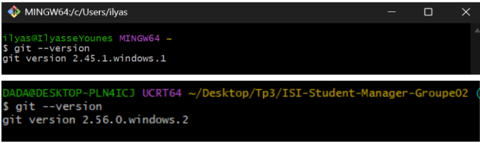](docs/images/capture-01.png)  

2. Configurer le nom et l’adresse e-mail de l’auteur des commits.

3. Afficher les paramètres et expliquer le rôle de user.name et user.email.

**`user.name`** indique le nom de l’auteur des commits. **`user.email`** indique son adresse e-mail. Ces paramètres identifient l’auteur dans l’historique Git.

[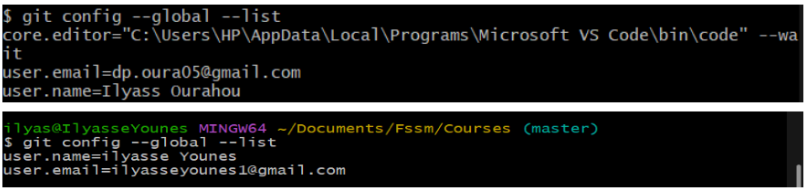](docs/images/capture-02.png)  

## Exercice 2  Création du dépôt commun

1. Créer le dépôt public ISI-Student-Manager-Groupe02 avec un fichier `README.md`.

Le dépôt public a été créé avec un fichier `README.md`.

2. Inviter les autres membres comme collaborateurs et accepter les invitations.

[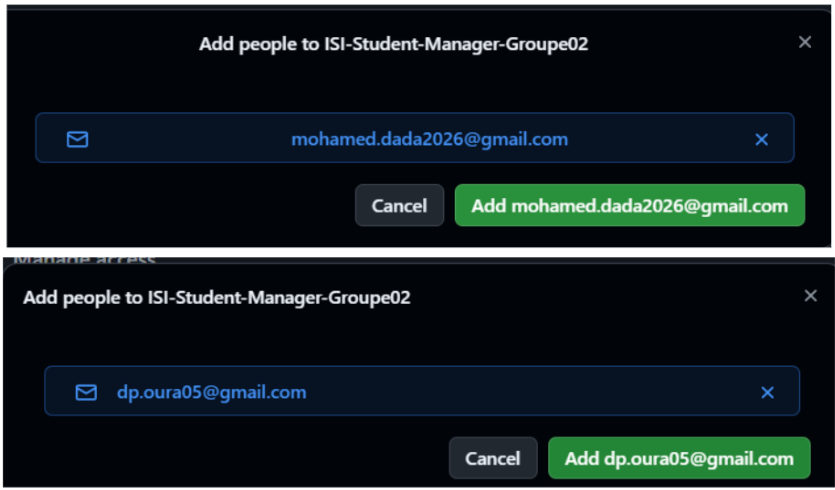](docs/images/capture-03.png)  

## Exercice 3  SSH et clonage du dépôt

1. Configurer une clé SSH Ed25519 et ajouter la clé publique à GitHub.

[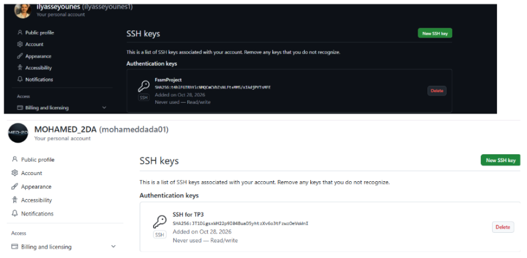](docs/images/capture-04.png)  
  
[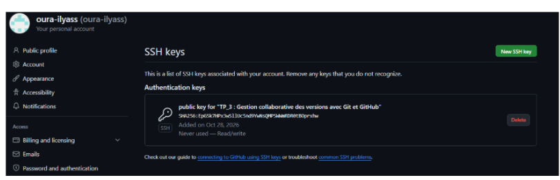](docs/images/capture-05.png)  

2. Cloner le dépôt sur chaque machine en utilisant son adresse SSH.

[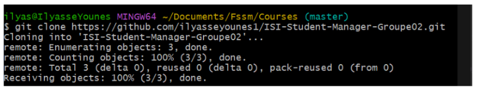](docs/images/capture-06.png)

3. Expliquer clone, origin, main, origin/main et HEAD.

**- clone** est une opération qui permet de copier un dépôt distant (sur GitHub) sur son ordinateur local. Elle récupère le projet et son historique Git, et configure généralement le dépôt distant sous le nom origin.  
**- origin** est le nom par défaut donné au dépôt distant lors du clonage. Il permet de communiquer avec le dépôt hébergé sur GitHub. 	  
- **main** est le nom de la branche principale du projet. Elle contient la version principale du code, dans laquelle les fonctionnalités sont intégrées après validation des Pull Requests.  
**- origin/main** est une référence locale qui représente le dernier état connu de la branche main sur le dépôt distant origin.   
**- HEAD** est une référence qui indique généralement la branche actuellement sélectionnée, ou plus précisément le commit actuellement consulté. 

## Exercice 4  Commit initial

1. A crée index.php avec le message « Bienvenue dans ISI Student Manager ».

[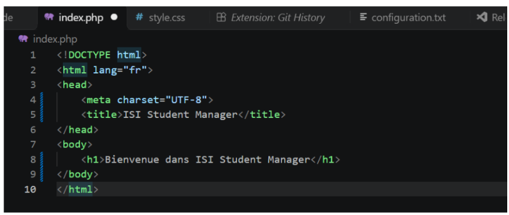](docs/images/capture-07.png)

2. Ajouter le fichier, créer un commit et le pousser vers main.

[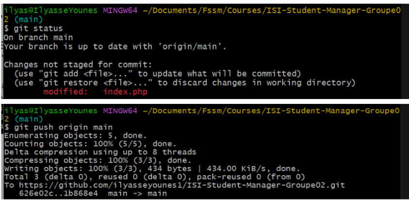](docs/images/capture-08.png)  

3. Les autres membres mettent à jour leur copie locale.

[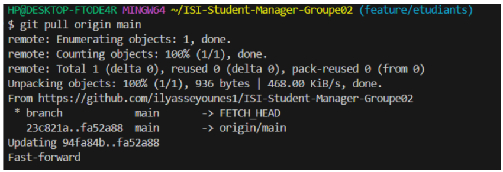](docs/images/capture-09.png)

4. Expliquer la différence entre commit et push.

Un **commit** enregistre les modifications dans l’historique du dépôt local, sur notre ordinateur.

Un **push** envoie les commits locaux vers le dépôt distant sur GitHub pour les partager avec les autres membres du groupe.

## Exercice 5  Branches individuelles

1. Mettre à jour main avant de créer les branches.

2. Créer la branche correspondant au rôle de chaque membre : feature/accueil, feature/etudiants, feature/projets ou feature/style.

[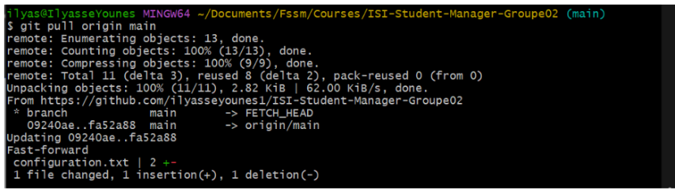](docs/images/capture-10.png)  
[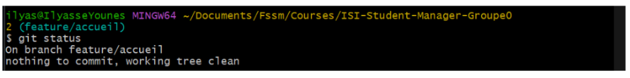](docs/images/capture-11.png)  

3. Vérifier la branche active.

La commande `git branch` affiche les branches locales. L’astérisque `*` indique la branche active ; `git status` affiche aussi son nom.

## Exercice 6  Développement en parallèle

1. B crée etudiants.php avec un tableau PHP de trois étudiants.

[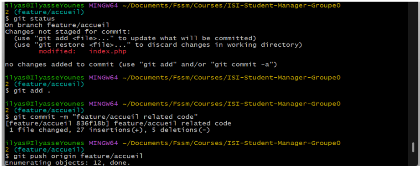](docs/images/capture-12.png)  
\  
[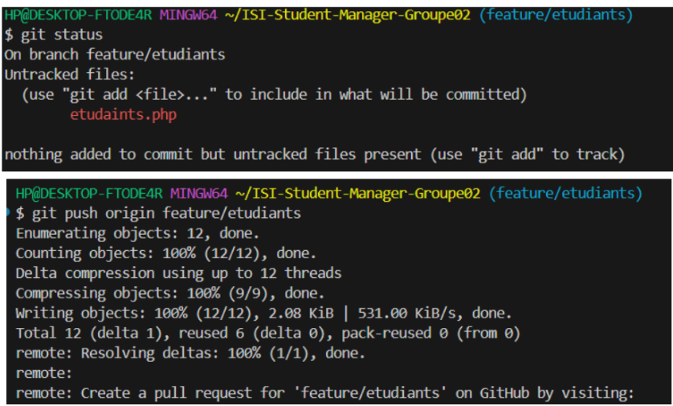](docs/images/capture-13.png)

2. C crée projets.php avec une liste de projets.

[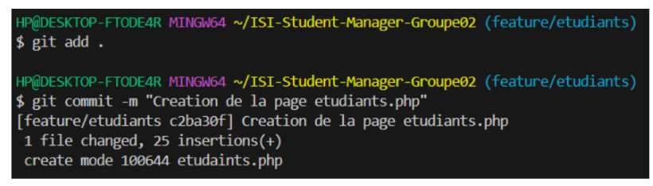](docs/images/capture-14.png)  

3. D crée style.css. Pour un groupe de trois, A prend aussi en charge le CSS.

[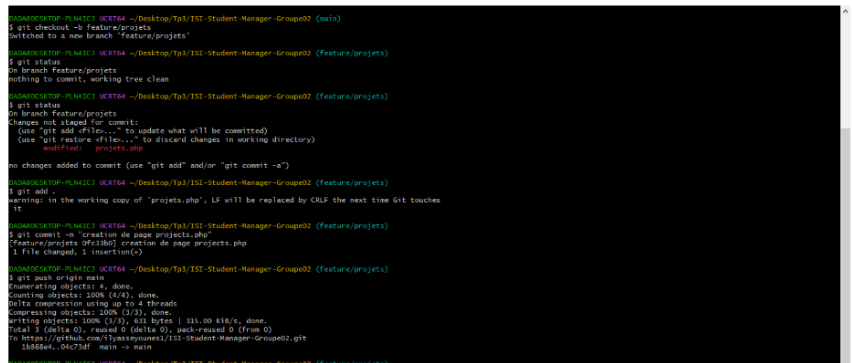](docs/images/capture-15.png)

[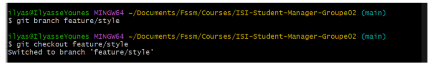](docs/images/capture-16.png)

## Exercice 7  Pull Requests et revue de code

1. Chaque membre ouvre une Pull Request vers main.

2. Un autre membre relit le code et laisse un commentaire technique utile avant la fusion : A → B → C → A pour notre groupe de trois membres.

[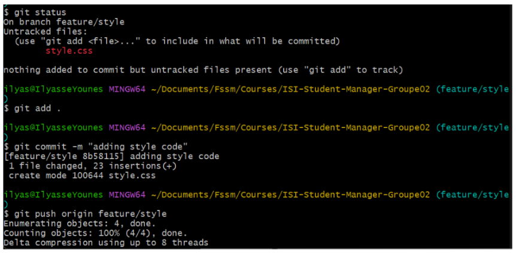](docs/images/capture-17.png)  
  
[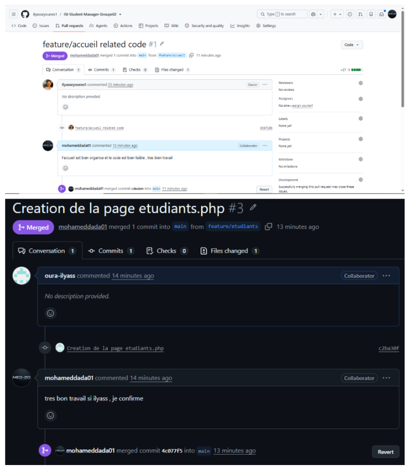](docs/images/capture-18.png)  

3. Fusionner les Pull Requests après validation, puis mettre à jour les branches main locales.

4. Expliquer l’intérêt d’une Pull Request par rapport à un push direct sur main.

Une **Pull Request** permet aux autres membres de relire les modifications, de laisser des commentaires et de demander des corrections avant leur fusion dans `main`. Un push direct modifie immédiatement `main`, sans cette étape de validation.

## Exercice 8  Conflit de fusion contrôlé

1. A ajoute configuration.txt avec le nom du projet, « Version : 1.0 » et le responsable du groupe.

[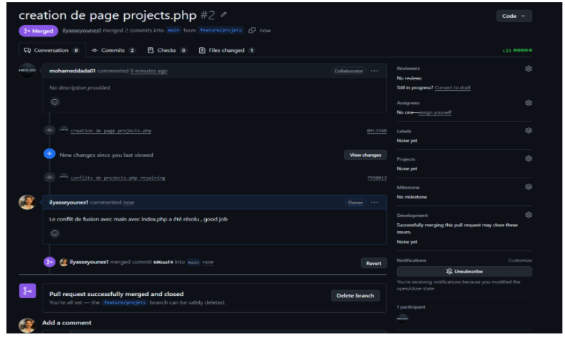](docs/images/capture-19.png)  

2. B et C créent deux branches à partir du même main. B écrit « Version : 2.0 - Etudiant B » et C écrit « Version : 3.0 - Etudiant C ».

[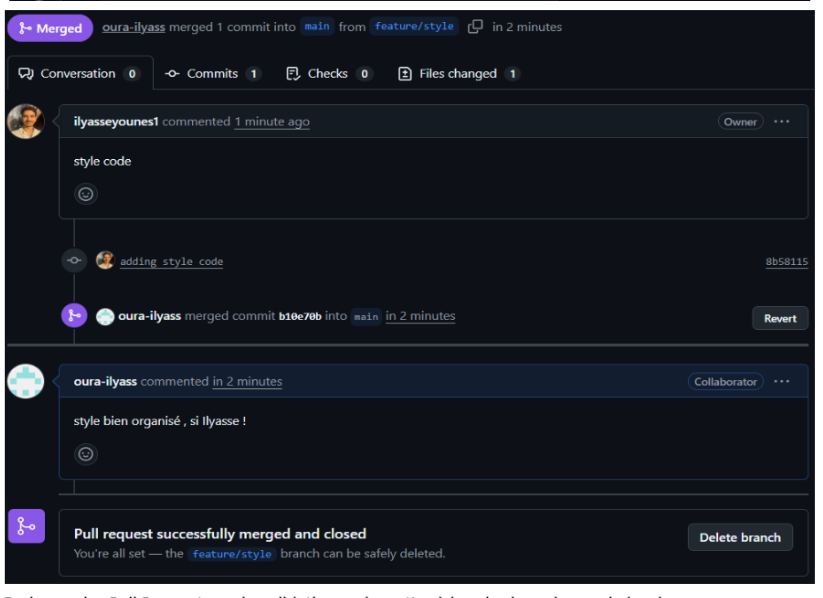](docs/images/capture-20.png)  

3. Publier et faire fusionner la Pull Request de C en premier.

4. B récupère origin/main et le fusionne dans sa branche pour provoquer le conflit.

[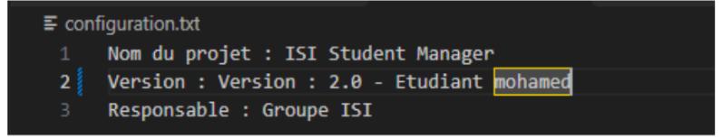](docs/images/capture-21.png)  

5. Résoudre le conflit avec « Version : 3.0 - Version collaborative », finaliser le commit, pousser la branche et ouvrir la Pull Request.

[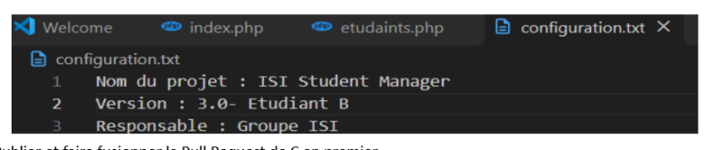](docs/images/capture-22.png)  

## Exercice 9  Vérification et livrables

1. Afficher l’historique graphique des commits et les branches.

```bash
git log --oneline --graph --all --decorate
git branch -a
```

2. Vérifier que main est à jour et que l’application fonctionne.

```bash
git switch main
git pull --ff-only origin main
git status
```

Ouvrir l’application dans le navigateur et vérifier l’accueil, les liens, les étudiants, les projets et le CSS.

[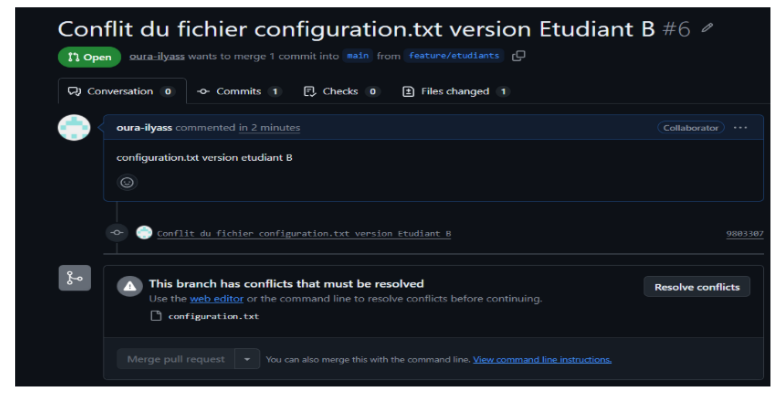](docs/images/capture-23.png)

3. Compléter README.md avec les membres, l’installation, l’exécution et les tâches réalisées. Fournir l’URL du dépôt.

Le dépôt du groupe est disponible ici : [ISI-Student-Manager-Groupe02](https://github.com/ilyasseyounes1/ISI-Student-Manager-Groupe02).

### Installation et exécution

Avec Git et PHP installés :

```bash
git clone git@github.com:ilyasseyounes1/ISI-Student-Manager-Groupe02.git
cd ISI-Student-Manager-Groupe02
php -S localhost:8000
```

